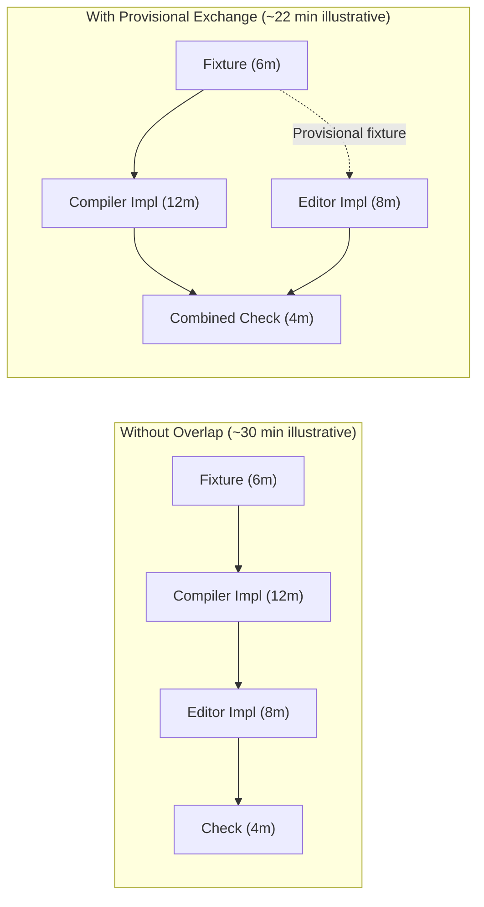

  

  <strong>Cross-tool intermediate result exchange, required awareness, and revision-anchored handoffs for coding agents.</strong>

  <a href="PROJECT.md">Read the Full Project Specification (PROJECT.md)</a> ·
  <a href="PROJECT.md#9-implementation-roadmap">Roadmap</a> ·
  <a href="PROJECT.md#10-validation-and-experimental-design">Validation Plan</a>

---

> **Project Status:** Design & Architecture Specification.  
> This repository currently defines Taaro's product architecture, trust boundaries, integration contract, and empirical validation plan. See [PROJECT.md](PROJECT.md) for the complete specification.

## What Is Taaro?

The most valuable thing one coding agent can hand another is often a **half-finished piece of work**—a failing bug reproducer hours before the fix lands, or a golden fixture and schema before an implementation is finished.

**Taaro** lets coding agents start useful work from intermediate outputs produced by other agents that are still coding, across different tools and sessions:

- **For solo developers:** Resume yesterday's bug fix or switch models with the exact failing reproducer, command, source revision, and open review thread already pinned—without paying a fresh session to rediscover how to trigger the bug.
- **For teams:** Let coupled work—such as a compiler change and its editor consumer, or an API and its client—move in parallel across different tools without a human shuttling updates between terminals.

Taaro operates through two cooperating surfaces:

1. **A GitHub App** that surfaces revision-anchored pull request handoff cards via the Checks API, discovers visible overlapping work, and provides an optional branch-protection awareness check.
2. **Supported Agent Runtime Adapters** that exchange opted-in provisional artifacts, deliver relevant active changes and design proposals directly into the acting worker's context before protected actions, and issue trusted delivery receipts.

---

## Why Taaro Exists

- **Serial waits on unfinished branches:** Downstream workers sit idle waiting for an upstream PR to merge when a narrow, executable fixture could unblock them minutes into the task.
- **Expensive session resets:** Context resets, model switches, and next-day handoffs force fresh sessions to burn context rediscovering reproducers or re-reading full transcripts (which risks reintroducing abandoned plans).
- **Silent parallel rework:** Independent agents working on the same issue or contract frequently touch different files, pass CI separately, and merge cleanly—only revealing duplication or contract breaks too late.
- **Checkpoint drag:** Asking agents to write narrative incremental commits after every small edit puts documentation pauses on the critical path. Taaro removes coordination overhead without demanding extra commits, templates, or progress prompts.

---

## How It Works: A Two-Agent Example

Suppose a developer asks their usual coding tool to add a secondary source span to compiler diagnostics and display it in the editor (illustrated on a compiler-and-editor project such as `Neura`):

1. **Provisional fixture publication:** The compiler worker creates an example diagnostic and expected output (a golden fixture). Its opted-in adapter publishes an immutable, task-scoped version marked `provisional` under a repository-approved sharing scope.
2. **Parallel consumption:** The editor worker receives the fixture immediately—even in a different client—and runs its decoder while the compiler worker keeps implementing. Neither owes progress reports or extra commits.
3. **Targeted revision delivery:** If the compiler worker later changes how an absent secondary span is encoded, Taaro knows which worker consumed the earlier fixture and delivers the changed field before the editor worker's next affected action.
4. **Early combined validation:** Once candidate patches exist, Taaro can invoke the team's existing CI on that exact pair of revisions in a disposable environment, giving both workers the same failing example. Normal merge and release checks still govern what ships.

*Honest baseline note: Timings are illustrative. An early draft PR can achieve similar overlap; Taaro earns its place only when it beats that baseline after accounting for publish time, interface churn, and reruns.*

---

## Core Capabilities

### 1. Intermediate Result Exchange

| Capability | What Changes | When It Pays Off |
| :--- | :--- | :--- |
| **Start with a runnable example** | A solo agent gets yesterday's exact reproducer, command, and revision, and reruns it on today's checkout first. | Switching models or resuming across days without rediscovering how to reproduce a bug. |
| **Use work while it is in progress** | A worker subscribes to a concrete output (fixture or schema); its planner runs other ready tasks or suspends until delivery. | Downstream work starts earlier without polling loops. |
| **Join an eligible check already running** | Multiple workers requesting the same reproducible check follow one run, keyed by build-system inputs, toolchain, and environment. | Avoids duplicate work when that check sits on the critical path. |
| **Try dependent changes together early** | Declared producer and consumer request one bounded compatibility test on their combined revisions. | Surfaces contract breaks while both workers are still active. |

### 2. Required Awareness of Active Work and Proposals

Inside a supported runtime, a worker may take a protected action **only after** its runtime delivers the current relevant changes and configured proposals (design PRs, labeled issues, versioned RFCs) into that worker's context:

- **No self-certification:** The trusted runtime—not the LLM—issues a delivery receipt scoped to `(worker, context_generation)`.
- **Hold and reconsider:** If a worker expands into a new scope or an applicable proposal changes mid-task (even on an unchanged Git commit), the action is held, the delta is delivered as quoted project data, and the worker gets a fresh turn to reconsider.
- **Fail closed on uncertainty:** Missing access, an unavailable index, or unverified delivery holds protected actions; a complete check with no matches clears automatically.
- **Optional branch protection:** Maintainers can require a dedicated GitHub App **Awareness Check** on protected branches (including merge-group SHAs), strictly separated from informational handoff cards.

### 3. Revision-Anchored Handoff Cards

Every handoff lives on the pull request (with exact commit SHAs pinned on every revision-specific fact) and is surfaced as a completed, optional, `neutral` GitHub Check Run only when there is something actionable to show—plus a copyable chat brief and a read-only CLI (e.g., `taaro context --pr 247`):

> **PR #247 · Point unterminated-string errors at the opening quote**
> - **Goal** *(issue #231)* — Point multiline unterminated-string diagnostics at the opening quote.
> - **Change at `91bd80a`** — Lexer sets `opening_span = token.span`; multiline case added to diagnostics fixture.
> - **Checks** — Linux diagnostics passed at `6f150de`; current head `91bd80a` queued.
> - **Open question** *(review of `6f150de`)* — *"Which span does the renderer show when the file ends immediately after a backslash?"* → Thread · Fixture
> - *Opened by Maya · Copy handoff · View diff since review*

### 4. Early Cross-Team Overlap Visibility

When independent PRs target the same linked issue or declared proposal scope (even in non-overlapping files that merge cleanly), Taaro surfaces a factual, dismissible comparison while both implementations are still inexpensive to adapt—without locking branches, reassigning owners, or nagging over shared lockfiles.

---

## Design Principles

- **Quiet on small fixes:** A straightforward typo fix with no overlap or open decision gets zero notices, zero required templates, and zero manual steps.
- **Provenance at the claim level:** Platform events, attributed human rationale, and Taaro suggestions are never blurred together. If no rationale was recorded, Taaro says so instead of fabricating one.
- **Works alongside your stack:** Your editor, models, task planner, Bazel/build cache, GitHub merge queues, and existing session tools stay in charge of what they already do well.
- **Least privilege and privacy by default:** Repository-by-repository GitHub App installation, deterministic handoffs with LLM processing of private source **off by default**, no private-to-public leakage, and no raw prompts or transcripts required in runtime coordination.
- **Repository outcomes, never developer surveillance:** Metrics track handoff reuse, wait reduction, and delivery impact—never per-person agent counts or lines-authored leaderboards.

---

## Roadmap

1. **Phase 1 — One Useful Exchange (MVP):** Single repository, one supported runtime, two worktrees, and one compatibility test. Automated provisional fixture handoff, runtime-enforced proposal awareness, PR handoff card, and solo next-day fixture reuse—using the same user prompt as before.
2. **Phase 2 — Portability & Enforcement Proof:** Move the consumer to a second client without changing the task or planner; pilot an opt-in branch-protected Awareness Check; run adversarial tests (stale proposals, missing receipts, uninstrumented edits, quiet typo fixes) and bounded combined CI runs.
3. **Phase 3 — Evidence-Driven Expansion:** Expand into cache sharing, cross-platform runner routing, and contract-to-consumer dependency matching only where real measurements show those delays dominate.

---

## Documentation Guide

All design details live in **[PROJECT.md](PROJECT.md)**:

| Section | What You'll Find |
| :--- | :--- |
| [1. Overview and Motivation](PROJECT.md#1-overview-and-motivation) | Problem framing, the incremental-commit trap, ideal users, and product discipline |
| [2. Core System Model and Capabilities](PROJECT.md#2-core-system-model-and-capabilities) | Architecture diagram, `Neura` walkthrough, four core capabilities, Bazel/merge-queue boundaries, project-scale vision |
| [3. Required Awareness](PROJECT.md#3-required-awareness-of-active-work-and-proposals) | Scope matching, proposal lifecycle, 4-point enforcement flow, runtime receipts, branch protection, freshness limits |
| [4. Handoff Cards and Lifecycle Utility](PROJECT.md#4-revision-anchored-handoff-cards-and-lifecycle-utility) | PR/commit/issue model, card anatomy, quiet small-fix rule, Checks API design, 7-stage lifecycle matrix |
| [5. Cross-Team Overlap Detection](PROJECT.md#5-cross-team-overlap-detection-and-rework-prevention) | Defensible comparisons, semantic/contract conflicts, ephemeral intent hints, pilot restraint |
| [6. Provenance and Runtime Integration](PROJECT.md#6-epistemology-provenance-and-runtime-integration) | Epistemic limits table, claim-level provenance, adapter mediation & prompt-injection boundaries |
| [7. Trust, Security, and Reliability](PROJECT.md#7-trust-security-and-operational-reliability) | Least-privilege GitHub permissions, force-push/squash/fork handling, webhook reliability, anti-surveillance policy |
| [8. Ecosystem and Adoption](PROJECT.md#8-ecosystem-positioning-and-adoption-strategy) | Positioning vs. Copilot/Entire/Merge Queues, solo-first 5-minute onboarding, open tool-builder protocol, business alignment |
| [9. Implementation Roadmap](PROJECT.md#9-implementation-roadmap) | Phased build milestones from single-repo exchange to evidence-driven expansion |
| [10. Validation and Experimental Design](PROJECT.md#10-validation-and-experimental-design) | Counterfactual baseline protocol, 6 structured evaluation experiments, measurement discipline, pilot success criteria |
